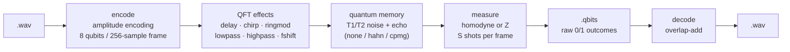
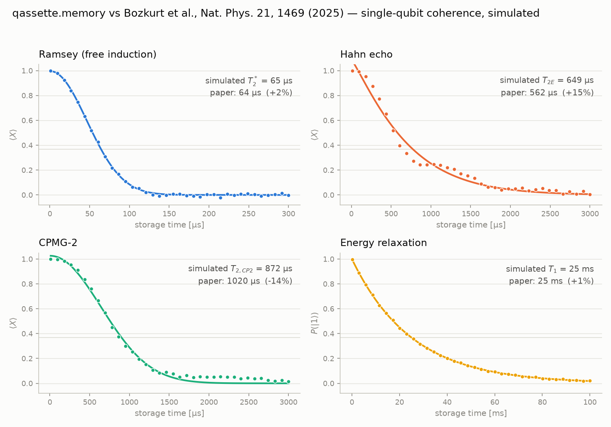

# 📼 qassette

**A cassette deck where the tape is a quantum state.**

qassette records audio into amplitude-encoded qubit states, runs effects as
quantum gates on the spectrum, stores each frame in a simulated mechanical
quantum memory with real decoherence physics, and plays the music back from
nothing but raw measurement shots. Every stage is honest quantum mechanics —
the lo-fi hiss *is* shot noise, the tape degradation *is* dephasing, and the
echo pulses that rescue the music are the same dynamical decoupling used on
real devices. Built on Qiskit, simulation only, for the Qollab 48h quantum
hackathon (Oct 9–11, 2026).

## Pipeline



## How it's quantum

Each claim below is backed by a reproducible ablation
(`python scripts\render_demo.py`, fixed seeds → `outputs/demo/`, metrics in
[`outputs/demo/ablations.md`](outputs/demo/ablations.md)):

- **Superposition** — one 8-qubit state holds all 256 samples of a frame, so
  a handful of phase gates transforms the entire frame at once: the whole
  effects rack is ~0–775 CNOTs per frame. Evidence: `fx_*.wav` (each effect
  matches its numpy reference to 1e-9 in exact mode; tests).
- **Interference** — amplitudes have signs, and only an interference
  measurement can see them. Z readout gets magnitudes only (corr with the
  signal −0.001, with |signal| 0.985 — audibly rectified); homodyne
  readout interferes against a reference and recovers the signed waveform
  (corr 0.978). Evidence: `readout_z.wav` vs `readout_homodyne.wav`. The
  echo is interference in time: it restores stored audio under our
  correlated noise (corr 0.979) but does nothing against memoryless
  dephasing with the same T2 (corr 0.009) — `dephasing_*_hahn.wav`.
- **Measurement** — a shot collapses a frame to one 8-bit sample; the song
  only exists in the statistics. Fidelity climbs 0.067 → 0.999 across
  1 → 65536 shots per frame with the textbook 1/√S error scaling (fitted
  slope −0.5002). Evidence: `shots_*.wav`, `bits_frame10.txt`.

## The paper connection

The memory stage simulates storing each qubit in its own phononic
oscillator, with parameters from **A. Bozkurt et al., "A mechanical qubit
memory in the millisecond regime", Nature Physics 21, 1469 (2025)**:
T1 = 25 ms, T2* = 64 µs, T2E = 562 µs, T2,CP2 = 1.02 ms. Dephasing is a
quasi-static Gaussian plus a random-telegraph fluctuator integrated across
echo pulse boundaries — deliberately *not* a memoryless error channel,
because an echo cannot refocus noise without memory (that is the ablation
above). A small optimizer (`scripts/calibrate.py`, reproduced in
`notebooks/calibration.ipynb`) tunes the noise so single-qubit Ramsey, Hahn,
CPMG-2 and T1 measurements land within ±15% of the paper:



One honest physics note: a single fluctuator cannot reach the paper's
CPMG/Hahn ratio of 1.82 (single-fluctuator ceiling ≈ 1.59 slow-limit,
~1.38 measured) — real devices see an ensemble of two-level systems; our
echoes land at +14.7% / −14.3% of the paper values.

## Quickstart (Windows / PowerShell)

```powershell
git clone <this-repo> qassette && cd qassette
py -3.11 -m venv .venv
.venv\Scripts\Activate.ps1
pip install -r requirements.txt
pip install -e .
python scripts\make_samples.py
pytest                       # 64 tests, ~8 min (statevector-heavy)
```

CLI — tape deck in four commands:

```powershell
qassette encode samples\a_major_chord_2s.wav -o song.qtape --fx "ringmod:16"
qassette measure song.qtape -o song.qbits --shots 4096 --readout homodyne --memory-time 300us --dd hahn
qassette decode song.qbits -o out.wav
qassette bits song.qbits --frame 10 --max-shots 32   # look at the raw 1s and 0s
```

Or everything at once, with fidelity metrics: `qassette roundtrip in.wav -o out.wav`.
Quantum spectrograms: `qassette spectrogram song.qtape -o spec.png`.

App:

```powershell
streamlit run app.py
```

## Honesty notes

- **Simulation only.** Exact statevectors (with an optional AerSimulator
  path); no quantum hardware was used or simulated at the pulse level.
- **Classical side-channel.** Per-frame L2 norms (loudness) travel
  classically in the tape headers; the quantum state stores only each
  frame's normalized shape. Post-selection success rates and the effect
  chain are also classical metadata.
- **Storage time is a simulated parameter.** `--memory-time 300us` advances
  the calibrated noise model; nothing waits 300 µs of wall-clock time.
- **Readout is expensive, and must be — Holevo's bound.** Nine measured
  qubits can yield at most ~9 classical bits per shot, but a frame encodes
  256 real amplitudes: faithful playback therefore needs thousands of shots
  per frame (error ∝ 1/√S). A 2 s clip at 65536 shots/frame is a 33 MB
  `.qbits` tape for 64 KB of WAV. Quantum states are spectacularly bad
  audio storage — hearing *why* is the point of this project.
- **Disclosure.** The project scaffold and the framing/encoding baseline
  were prototyped by the author with AI assistance shortly before the event
  and rebuilt at kickoff as the starting point, per the event rules on
  disclosed starting material; everything beyond that baseline is in-window
  work, also built with heavy AI pair-programming.

## Repo map

```
qassette/        the package: audio_io (framing/COLA), encode, effects,
                 memory (Bozkurt-calibrated noise), readout, formats
                 (.qtape/.qbits), decode, viz, cli
app.py           Streamlit front-end (tape deck + "is it quantum?" tab)
scripts/         make_samples, calibrate, render_demo
tests/           64 pytest tests (exact references, stats, round-trips)
notebooks/       calibration.ipynb
docs/            calibration.png, demo_script.md
samples/         generated 16 kHz test WAVs
outputs/demo/    reproducible demo assets + ablations.md (WAVs gitignored)
```

## Team & license

Sophia Ren (Stanford) — solo, with AI pair-programming disclosed above.
MIT licensed (see [LICENSE](LICENSE)).
